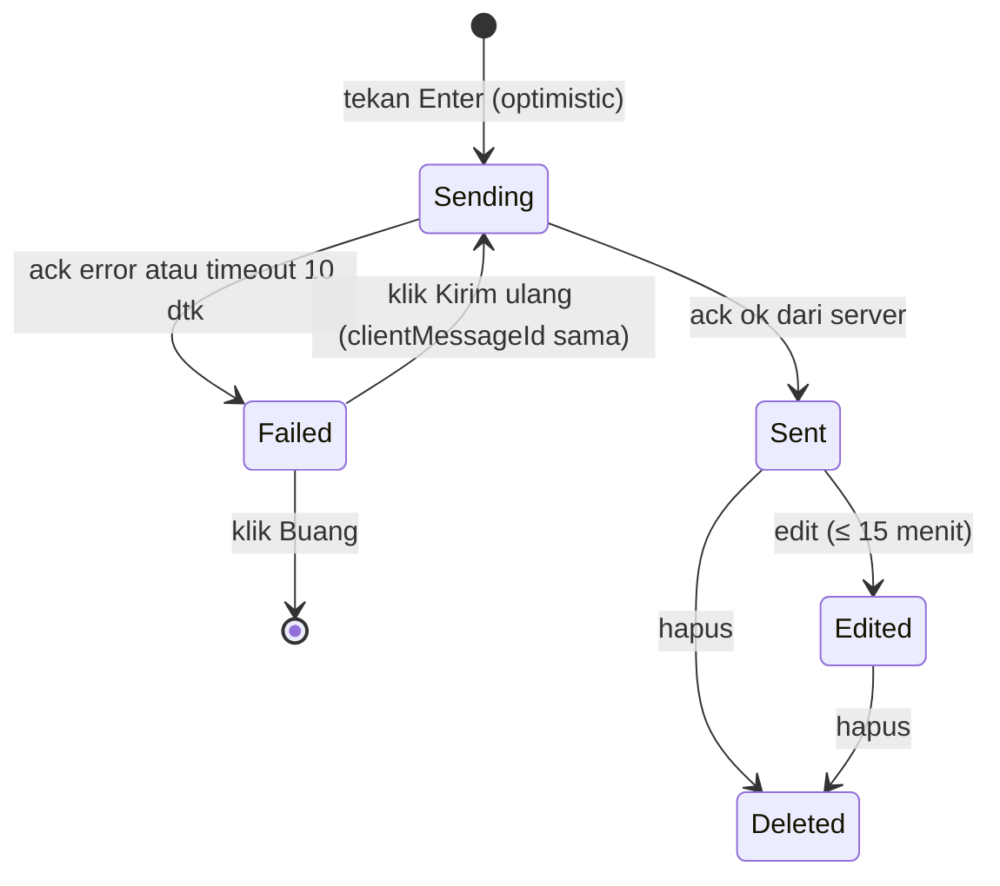

# Design — Kumpul (UI/UX & Design System)

> Dokumen terkait: [PRD.md](./PRD.md) · [rules.md](./rules.md) · [architecture.md](./architecture.md) · [schema.md](./schema.md)
> Semua nilai warna/ukuran di sini adalah **design token**. Implementasi FE wajib memakai token (CSS variables), bukan nilai mentah.

---

## 1. Arah desain

**Subjek:** aplikasi chat grup untuk komunitas berbahasa Indonesia, dengan dua "kelas" ruang: **grup publik** yang terbuka dan **grup VIP** yang eksklusif.
**Audiens:** anggota komunitas (mobile-first, sering di jaringan tidak stabil) dan Admin yang mengelola banyak grup.
**Tugas utama UI:** membuat percakapan terasa cepat dan jelas, membuat perbedaan publik vs VIP terbaca sekilas, dan membuat pekerjaan Admin efisien.

### 1.1 Prinsip

1. **Percakapan adalah bintangnya.** Chrome antarmuka tenang dan netral; warna kuat hanya untuk yang penting (pesan sendiri, belum dibaca, VIP).
2. **Struktur membawa informasi.** Bentuk, garis, dan warna dipakai untuk menyampaikan arti (jenis grup, status pesan), bukan hiasan.
3. **Kejujuran status.** Pengguna selalu tahu: pesan sedang dikirim, terkirim, gagal, atau koneksi terputus.
4. **Hemat gerak.** Animasi hanya sebagai respons atas aksi pengguna; satu momen khusus yang disengaja (lihat 1.3).
5. **Bahasa sehari-hari.** Teks UI jelas, kalimat aktif, huruf kapital hanya di awal kalimat.

### 1.2 Elemen ikonik: "benang emas" dan bentuk avatar

Perbedaan jenis grup dikodekan secara konsisten di seluruh UI:

| | Grup **Publik** | Grup **VIP** |
|---|---|---|
| Bentuk avatar | **Lingkaran** | **Squircle** (radius 30%) |
| Bingkai avatar | Tanpa bingkai | Cincin emas 2 px |
| Item di daftar grup | Standar | Garis emas 3 px di sisi kiri |
| Header chat | Standar | Garis emas tipis (2 px) di sisi bawah header |
| Lencana | — | Lencana teks "VIP" (warna emas tua di atas latar emas muda) |

Ini satu-satunya "aksen berani" pada produk. Selebihnya sengaja dibuat diam.

### 1.3 Satu momen animasi

Saat pengajuan VIP **disetujui** dan pengguna pertama kali membuka grup barunya, garis emas di header **"ditarik"** dari kiri ke kanan (600 ms, `ease-out`, sekali saja). Tidak ada animasi masuk lain di seluruh aplikasi selain respons langsung atas aksi (buka/tutup panel, toast, dsb.). Dengan `prefers-reduced-motion`, garis langsung tampil penuh.

---

## 2. Design tokens

### 2.1 Warna

Nama warna mengambil suasana laut dan kebiasaan sehari-hari; nilai hex adalah sumber kebenaran.

| Token | Nama | Light | Dark | Fungsi |
|---|---|---|---|---|
| `--bg` | Kabut | `#EEF2F1` | `#0D1719` | Latar aplikasi |
| `--surface` | Kertas | `#FFFFFF` | `#142225` | Panel, kartu, bubble lawan bicara |
| `--surface-2` | Embun | `#E4EAE8` | `#1B2E32` | Hover, input, panel sekunder |
| `--border` | Garis | `#D3DCDA` | `#26393D` | Pembatas |
| `--ink` | Tinta | `#14262B` | `#E6EEEC` | Teks utama |
| `--ink-muted` | Tinta pudar | `#526468` | `#98ADB0` | Teks sekunder, timestamp |
| `--primary` | Laut | `#0E6B70` | `#3FB6BC` | Aksi utama, tautan, fokus |
| `--primary-hover` | Laut tua | `#0A565A` | `#5BC6CB` | Hover tombol utama |
| `--primary-soft` | Laut muda | `#D5EBEC` | `#14383B` | Latar mention, item terpilih |
| `--on-primary` | — | `#FFFFFF` | `#062326` | Teks di atas `--primary` |
| `--bubble-own` | Gelembung saya | `#0E6B70` | `#1B7F85` | Latar pesan sendiri (teks putih) |
| `--vip` | Emas | `#C9962B` | `#E2B34F` | Cincin/garis VIP (non-teks) |
| `--vip-soft` | Emas muda | `#F8EBC8` | `#3A2E12` | Latar lencana VIP |
| `--vip-text` | Emas tua | `#7A4F00` | `#F0CB7A` | Teks lencana VIP (kontras ≥ 4.5:1) |
| `--danger` | Bahaya | `#B42318` | `#F0776B` | Hapus, error |
| `--danger-soft` | — | `#FDE7E4` | `#3B1A17` | Latar peringatan error |
| `--success` | Sukses | `#1F7A4D` | `#4FC38A` | Terkirim, online, disetujui |
| `--warning` | Peringatan | `#A15C07` | `#E8A94B` | Menunggu, koneksi bermasalah |

**Aturan warna**

- Jangan pernah menyampaikan status **hanya** dengan warna; sertakan ikon/teks.
- Warna nama pengirim di grup memakai 8 warna palet tetap yang dipilih deterministik dari hash `userId` (semua lulus kontras 4.5:1 di atas `--surface` pada kedua tema).
- Latar `--vip*` hanya untuk elemen bertanda VIP.

### 2.2 Tipografi

| Peran | Font | Catatan |
|---|---|---|
| UI & konten | **Plus Jakarta Sans** | Dirancang di Indonesia, terbaca baik untuk teks pendek dan panjang. Bobot 400, 500, 600, 700. |
| Kode dalam pesan | **JetBrains Mono** | Hanya untuk `kode inline` dan blok kode di pesan. |

Muat lewat `next/font` dengan `display: swap` dan fallback `system-ui, -apple-system, "Segoe UI", sans-serif`.

| Token | Ukuran / tinggi baris | Bobot | Pemakaian |
|---|---|---|---|
| `text-xs` | 12 / 16 | 500 | Timestamp, lencana |
| `text-sm` | 13 / 18 | 400–500 | Meta, helper text, cuplikan pesan di daftar |
| `text-base` | **15 / 22** | 400 | **Isi pesan**, teks umum |
| `text-md` | 17 / 24 | 600 | Nama grup di header, judul kartu |
| `text-lg` | 20 / 28 | 600 | Judul halaman/modal |
| `text-xl` | 24 / 32 | 700 | Judul halaman utama |
| `text-2xl` | 32 / 40 | 700 | Halaman Masuk/Daftar |

Aturan: lebar baris konten < 80 karakter (bubble maks. 70% lebar area chat, batas absolut 560 px); tanpa huruf kapital semua untuk label; letter-spacing default kecuali `text-2xl` (−0,01em).

### 2.3 Spasi, radius, elevasi

- **Spasi** (kelipatan 4 px): `4, 8, 12, 16, 20, 24, 32, 40, 48, 64`.
- **Radius** — bervariasi sesuai peran, bukan satu nilai untuk semua:

| Token | Nilai | Pemakaian |
|---|---|---|
| `--r-sm` | 6 px | Input, tombol, chip |
| `--r-md` | 10 px | Kartu, popover |
| `--r-lg` | 16 px | Modal, **bubble pesan** (sudut sisi pengirim bawah 4 px) |
| `--r-full` | 9999 px | Avatar publik, badge, dot |
| `--r-squircle` | 30% | Avatar VIP |

- **Elevasi**: dasar memakai **garis 1 px `--border`**, bukan bayangan. Bayangan hanya untuk elemen yang melayang: `0 8px 24px rgba(20, 38, 43, 0.14)` (popover, modal, toast).

### 2.4 Motion

| Token | Nilai | Pemakaian |
|---|---|---|
| `--dur-fast` | 120 ms | Hover, toggle |
| `--dur-base` | 180 ms | Buka/tutup panel, dropdown |
| `--dur-slow` | 600 ms | Hanya "benang emas" (1.3) |
| `--ease` | `cubic-bezier(0.2, 0, 0, 1)` | Semua transisi |

Pesan baru muncul **tanpa animasi** (langsung), supaya terasa instan. Semua transisi dimatikan pada `prefers-reduced-motion: reduce`.

### 2.5 Implementasi token

```css
/* apps/frontend/src/styles/tokens.css */
:root {
  --bg: #EEF2F1;  --surface: #FFFFFF;  --surface-2: #E4EAE8;  --border: #D3DCDA;
  --ink: #14262B; --ink-muted: #526468;
  --primary: #0E6B70; --primary-hover: #0A565A; --primary-soft: #D5EBEC; --on-primary: #FFFFFF;
  --bubble-own: #0E6B70;
  --vip: #C9962B; --vip-soft: #F8EBC8; --vip-text: #7A4F00;
  --danger: #B42318; --danger-soft: #FDE7E4; --success: #1F7A4D; --warning: #A15C07;
  --r-sm: 6px; --r-md: 10px; --r-lg: 16px;
  --ease: cubic-bezier(0.2, 0, 0, 1);
}
:root[data-theme="dark"] {
  --bg: #0D1719;  --surface: #142225;  --surface-2: #1B2E32;  --border: #26393D;
  --ink: #E6EEEC; --ink-muted: #98ADB0;
  --primary: #3FB6BC; --primary-hover: #5BC6CB; --primary-soft: #14383B; --on-primary: #062326;
  --bubble-own: #1B7F85;
  --vip: #E2B34F; --vip-soft: #3A2E12; --vip-text: #F0CB7A;
  --danger: #F0776B; --danger-soft: #3B1A17; --success: #4FC38A; --warning: #E8A94B;
}
@media (prefers-reduced-motion: reduce) {
  * { animation-duration: 0.01ms !important; transition-duration: 0.01ms !important; }
}
```

Tailwind memetakan token: `colors: { bg: "var(--bg)", surface: "var(--surface)", ink: "var(--ink)", primary: "var(--primary)", vip: "var(--vip)", ... }`. Tema mengikuti `prefers-color-scheme` secara default dan dapat diganti di Pengaturan.

---

## 3. Layout & responsivitas

### 3.1 Breakpoint

| Nama | Lebar | Layout |
|---|---|---|
| `sm` (mobile) | < 768 px | Satu panel pada satu waktu: daftar grup → chat (dengan tombol kembali). Info grup berupa *bottom sheet*. |
| `md` (tablet) | 768–1199 px | Dua panel: daftar grup + chat. Info grup sebagai *drawer* dari kanan. |
| `lg` (desktop) | ≥ 1200 px | Tiga area: rail navigasi + daftar grup + chat, info grup dapat dipin di kanan. |

### 3.2 Wireframe — layar chat (desktop)

```
┌──────┬────────────────────┬──────────────────────────────────────┬───────────────────┐
│ Rail │ Grup saya          │ (●) Umum                  128 anggota│ Info grup         │
│      │ ┌────────────────┐ │──────────────────────────────────────│                   │
│ [C]  │ │ Cari grup      │ │                                      │ Deskripsi         │
│ chat │ └────────────────┘ │  Rani                                │ Ruang ngobrol     │
│      │                    │  ┌──────────────────────────┐        │ santai untuk semua│
│ [J]  │ (●) Umum        3  │  │ Halo semua, ada yang     │        │                   │
│ jela-│     Rani: halo…    │  │ tahu jadwal kopdar?      │ 10.42  │ Anggota (128)     │
│ jah  │                    │  └──────────────────────────┘        │  ● Budi   Moderator│
│      │ [▣] Tim Backend VIP│                                      │  ● Sinta          │
│ [V]  │ ▌   Kamu: siap!    │        ┌────────────────────────┐    │  ○ Dodi           │
│ VIP  │                    │  10.43 │ Sabtu jam 4 sore ya    │    │                   │
│      │ (●) Tanya Jawab    │        └────────────────────────┘    │ [Keluar dari grup]│
│ [N]  │     Budi: cek doc… │  ─────────  Pesan baru  ──────────   │                   │
│ lonc-│                    │  Budi sedang mengetik…               │                   │
│ eng  │                    │ ┌──────────────────────────────┬───┐ │                   │
│      │                    │ │ Tulis pesan…            [🖼]  │ ➤ │ │                   │
│ [P]  │                    │ └──────────────────────────────┴───┘ │                   │
│ profil                    │                                      │                   │
└──────┴────────────────────┴──────────────────────────────────────┴───────────────────┘
 (●) = avatar lingkaran (publik)    [▣] = avatar squircle + cincin emas (VIP)    ▌ = garis emas kiri (VIP)
```

Ukuran: rail 64 px · daftar grup 320 px · area chat fleksibel (min 480 px) · info grup 320 px.
Perataan: pesan lawan bicara rata kiri, pesan sendiri rata kanan; teks di dalam bubble rata kiri.

### 3.3 Wireframe — mobile

```
┌─────────────────────────┐      ┌─────────────────────────┐
│ Kumpul            🔔 ⚙  │      │ ‹  [▣] Tim Backend VIP ⓘ│
│ ┌─────────────────────┐ │      │ ━━━━━━━━━━━━━━━━━━━━━━━ │ ← garis emas
│ │ Cari grup           │ │      │ Rani                    │
│ └─────────────────────┘ │      │ ┌─────────────────────┐ │
│ (●) Umum           3    │      │ │ Halo semua…         │ │
│ [▣] Tim Backend VIP  ▌  │      │ └─────────────────────┘ │
│ (●) Tanya Jawab         │      │        ┌──────────────┐ │
│                         │      │        │ Siap!        │ │
│                         │      │        └──────────────┘ │
│                         │      │ ┌───────────────────┬──┐│
│                         │      │ │ Tulis pesan…      │➤ ││
│ ┌───┬───┬───┬───┐       │      │ └───────────────────┴──┘│
│ │Cht│Jlh│VIP│Prf│ ←tab  │      └─────────────────────────┘
└─────────────────────────┘
```

Mobile memakai *bottom tab bar* (Chat, Jelajah, VIP, Profil). Area sentuh minimal 44 × 44 px. Composer mengikuti `env(safe-area-inset-bottom)` dan tidak tertutup keyboard virtual (gunakan `100dvh`).

---

## 4. Komponen

### 4.1 Katalog

| Komponen | Spesifikasi |
|---|---|
| **Avatar** | Ukuran 24/32/40/56/96. `type=PUBLIC` → lingkaran; `type=VIP` → squircle + cincin `--vip` 2 px. Fallback: inisial (1–2 huruf) di atas warna hash. Titik presence 10 px di pojok kanan bawah untuk user. |
| **GroupListItem** | Tinggi 64 px. Avatar 40, nama (`text-md`, 1 baris terpotong), cuplikan pesan terakhir (`text-sm`, `--ink-muted`), waktu (`text-xs`), badge belum dibaca. Terpilih: latar `--primary-soft`. VIP: garis emas 3 px di kiri. Bisu: ikon lonceng dicoret. |
| **UnreadBadge** | Bulat `--primary` teks `--on-primary`; tampil "99+" jika > 99. Grup dibisukan: `--ink-muted`. |
| **VipBadge** | Teks "VIP", `text-xs` bobot 600, `--vip-text` di atas `--vip-soft`, radius `--r-full`. |
| **MessageBubble** | Maks. lebar 70% (≤ 560 px). Sendiri: `--bubble-own` teks putih, rata kanan. Lawan: `--surface` + garis `--border`, nama pengirim berwarna. Radius `--r-lg`, sudut sisi pengirim bawah 4 px. Pesan beruntun dari pengirim sama dalam 5 menit dikelompokkan (avatar & nama hanya di pesan pertama). Timestamp `text-xs` tampil pada hover/tap, dan selalu tampil pada pesan terakhir kelompok. |
| **MessageStatus** | Ikon kecil di pesan sendiri: jam (mengirim) → centang (terkirim) → segitiga peringatan + tautan "Kirim ulang" (gagal). Selalu disertai `aria-label`. |
| **ReplyQuote** | Blok kutipan di dalam bubble: garis kiri 3 px `--primary`, nama pengirim + 1–2 baris teks asal. |
| **DeletedMessage** | Teks miring `--ink-muted`: "Pesan ini telah dihapus" atau "Pesan dihapus oleh moderator". |
| **Composer** | Textarea auto-grow (1–6 baris), `Enter` kirim, `Shift+Enter` baris baru, penghitung karakter muncul mulai 3.500. Tombol lampiran gambar. Saat membalas: strip "Membalas Rani" dengan tombol batal. Nonaktif dengan penjelasan bila grup diarsipkan atau pengguna dibisukan. |
| **TypingIndicator** | Teks + tiga titik statis bergantian tampil (tanpa animasi bila reduced-motion). "Rani sedang mengetik…", "Rani dan Budi sedang mengetik…", "3 orang sedang mengetik…". Diletakkan tepat di atas composer. |
| **NewMessagesDivider** | Garis + teks "Pesan baru" di antara pesan terbaca dan belum dibaca. |
| **JumpToLatest** | Tombol melayang saat pengguna scroll ke atas dan ada pesan baru: "3 pesan baru ↓" (klik → scroll ke bawah). |
| **ConnectionBanner** | Strip di atas area chat: "Menyambung ulang…" (`--warning`) atau "Koneksi terputus. Pesan akan dikirim setelah tersambung." Hilang otomatis 2 detik setelah tersambung. |
| **NotificationBell** | Ikon + badge jumlah. Popover daftar notifikasi (maks. 20, "Lihat semua"), tombol "Tandai semua dibaca". |
| **Toast** | Pojok kanan bawah (desktop) / atas (mobile), 5 detik, dapat ditutup. Kata kerja sama dengan tombol pemicunya ("Pengajuan dikirim"). |
| **ConfirmDialog** | Untuk aksi merusak: judul jelas, penjelasan dampak, tombol bahaya berlabel aksi ("Hapus grup"), untuk aksi berat minta ketik nama grup. |
| **EmptyState** | Ikon sederhana + satu kalimat + satu aksi. Lihat 6.2. |
| **Skeleton** | Pengganti spinner untuk daftar grup dan riwayat pesan. |
| **DataTable (Admin)** | Header lengket, baris 48 px, filter di atas, pagination kursor, aksi baris lewat menu "⋯". |
| **StatusPill** | `PENDING` (warning), `APPROVED` (success), `REJECTED` (danger), `CANCELLED` (netral); selalu ikon + teks: "Menunggu", "Disetujui", "Ditolak", "Dibatalkan". |

### 4.2 Perilaku daftar pesan

- Virtualisasi (TanStack Virtual) dengan tinggi item dinamis.
- Buka grup → langsung ke pesan belum dibaca pertama; bila tidak ada, ke dasar.
- Pengguna **di dasar** (dalam 80 px) → pesan baru otomatis di-scroll. Pengguna **di atas** → tampilkan *JumpToLatest*, jangan geser posisi.
- Memuat riwayat lama (scroll ke atas) **mempertahankan posisi** (scroll anchoring).
- Pesan baru dipublikasikan ke `aria-live="polite"` (ringkas: "Pesan baru dari Rani").

### 4.3 Siklus status pesan sendiri



---

## 5. Peta layar

| Layar | Ringkasan |
|---|---|
| Masuk / Daftar | Satu kolom terpusat di atas latar `--bg`, form di kartu putih. Judul `text-2xl`, satu tombol utama. |
| Chat | Lihat 3.2. |
| Jelajah | Kolom pencarian besar di atas; grid kartu grup publik (avatar, nama, deskripsi 2 baris, jumlah anggota, tombol "Gabung"). |
| Gabung via kode | Kartu pratinjau grup (avatar squircle, nama, deskripsi, jumlah anggota) + tombol "Gabung ke grup". |
| Ajukan grup VIP | Form satu kolom + panel samping berisi cara kerja (3 langkah nyata: kirim → Admin meninjau → grup dibuat). |
| Pengajuan saya | Daftar kartu dengan `StatusPill`, tanggal, catatan Admin; tombol "Batalkan pengajuan" pada yang menunggu. |
| Pengaturan | Tab: Profil, Akun (password), Tampilan (tema), Notifikasi. |
| Admin — Dashboard | Baris ringkasan angka (kartu polos tanpa gradien), daftar "Pengajuan VIP menunggu" (aksi cepat), grafik pesan 7 hari. |
| Admin — Grup | Tabel + tombol "Buat grup"; detail grup: tab Ringkasan, Anggota, Pengaturan, Zona bahaya. |
| Admin — Pengajuan VIP | Tabel dengan filter status; klik baris membuka panel samping detail + tombol Setujui / Tolak. |
| Admin — Pengguna | Tabel, pencarian, aksi Suspend / Ubah role. |
| Admin — Audit log | Tabel dengan filter aktor, aksi, rentang tanggal. |

### 5.1 Wireframe — review pengajuan VIP (Admin)

```
┌────────────────────────────────────────────────────────────────────────────┐
│ Pengajuan VIP                            Filter: [Menunggu ▾]  [Cari…     ] │
├──────────────────────────────────────────────┬─────────────────────────────┤
│ Pemohon        Nama grup         Diajukan    │ Tim Backend                 │
│ ──────────────────────────────────────────── │ Diajukan oleh @rani, 2 jam  │
│ @rani          Tim Backend       2 jam lalu ◀│ lalu                        │
│ @dodi          Klub Buku         1 hari lalu │                             │
│ @sinta         Fotografi         2 hari lalu │ Deskripsi                   │
│                                              │ Diskusi backend internal    │
│                                              │                             │
│                                              │ Tujuan                      │
│                                              │ Berbagi praktik terbaik…    │
│                                              │                             │
│                                              │ Perkiraan anggota: 40       │
│                                              │ Batas anggota: [ 100      ] │
│                                              │                             │
│                                              │ [ Tolak ]     [ Setujui ]   │
└──────────────────────────────────────────────┴─────────────────────────────┘
```

Tombol **Tolak** membuka dialog dengan kolom catatan (wajib ≥ 10 karakter; ditampilkan ke pemohon).

### 5.2 Wireframe — form ajukan grup VIP

```
┌───────────────────────────────────────────────┬────────────────────────────┐
│ Ajukan grup VIP                               │ Cara kerjanya              │
│                                               │ 1. Kamu kirim pengajuan    │
│ Nama grup                                     │ 2. Admin meninjau, biasanya│
│ [                                          ]  │    dalam 1 hari            │
│ Deskripsi singkat                             │ 3. Jika disetujui, kamu    │
│ [                                          ]  │    jadi Owner dan mendapat │
│ Untuk apa grup ini dibuat?                    │    kode undangan           │
│ [                                          ]  │                            │
│ Perkiraan jumlah anggota                      │ Batas: 1 pengajuan menunggu│
│ [ 20 ]                                        │ dan 3 grup VIP aktif.      │
│                                               │                            │
│ [ Kirim pengajuan ]                           │                            │
└───────────────────────────────────────────────┴────────────────────────────┘
```

(Angka 1–3 di panel samping dibenarkan karena memang urutan langkah.)

---

## 6. Microcopy & keadaan khusus

### 6.1 Nada bahasa

Ramah, lugas, tanpa basa-basi, kalimat aktif, huruf kapital hanya di awal kalimat. Nama aksi **konsisten** dari tombol hingga toast. Error tidak meminta maaf dan selalu menyebut apa yang salah serta cara memperbaikinya.

| Situasi | Teks |
|---|---|
| Tombol kirim pengajuan | "Kirim pengajuan" → toast "Pengajuan dikirim" |
| Tombol gabung | "Gabung" → toast "Kamu bergabung ke Umum" |
| Login gagal | "Email atau password salah. Periksa lagi lalu coba masuk." |
| Akun disuspend | "Akun ini dinonaktifkan. Hubungi Admin untuk bantuan." |
| Grup penuh | "Grup ini sudah penuh. Coba grup lain di Jelajah." |
| Kode undangan salah | "Kode undangan tidak berlaku. Minta kode terbaru ke Owner grup." |
| Pesan gagal | "Pesan belum terkirim." + "Kirim ulang" |
| Rate limit | "Terlalu cepat. Tunggu beberapa detik sebelum mengirim lagi." |
| Diarsipkan | "Grup ini diarsipkan. Kamu masih bisa membaca, tetapi tidak bisa mengirim pesan." |
| Dikeluarkan | "Kamu dikeluarkan dari Tim Backend." |
| Pengajuan disetujui | "Pengajuanmu untuk Tim Backend disetujui. Buka grup" |
| Pengajuan ditolak | "Pengajuanmu untuk Tim Backend ditolak. Lihat catatan Admin" |
| Pengajuan tertunda ada | "Kamu masih punya pengajuan yang menunggu. Batalkan atau tunggu hasilnya." |

### 6.2 Empty state

| Konteks | Teks | Aksi |
|---|---|---|
| Belum punya grup | "Kamu belum bergabung ke grup mana pun." | "Jelajahi grup" |
| Grup baru tanpa pesan | "Belum ada pesan. Mulai obrolan dengan menyapa." | Fokus ke composer |
| Tidak ada hasil cari | "Tidak ada grup bernama “…”." | "Hapus pencarian" |
| Belum ada pengajuan | "Kamu belum pernah mengajukan grup VIP." | "Ajukan grup VIP" |
| Tidak ada notifikasi | "Belum ada notifikasi." | — |
| Admin: tidak ada pengajuan | "Tidak ada pengajuan yang menunggu." | — |

### 6.3 Error & loading

- Muat awal: *skeleton* (bukan spinner tengah layar).
- Gagal memuat: pesan singkat + tombol "Coba lagi" (jangan hanya "Terjadi kesalahan").
- 403 / 404 pada grup: layar khusus "Kamu tidak punya akses ke grup ini" / "Grup tidak ditemukan" dengan tombol kembali.
- Sesi kedaluwarsa: coba refresh diam-diam; bila gagal, arahkan ke `/login?next=…` dengan pesan "Sesimu berakhir. Masuk lagi untuk melanjutkan."

---

## 7. Interaksi & pintasan keyboard

| Pintasan | Aksi |
|---|---|
| `Enter` / `Shift+Enter` | Kirim / baris baru |
| `↑` (composer kosong) | Edit pesan terakhir milik sendiri (jika ≤ 15 menit) |
| `Esc` | Batalkan balasan/edit; tutup dialog & panel |
| `Ctrl/Cmd + K` | Fokus ke pencarian grup |
| `Alt + ↑ / ↓` | Pindah ke grup sebelumnya/berikutnya |
| `@` | Buka autocomplete mention |

Pesan: tekan lama (mobile) atau klik kanan/ikon "⋯" (desktop) → Balas, Salin, Edit, Hapus (sesuai hak akses).

---

## 8. Aksesibilitas (target WCAG 2.1 AA)

- Kontras teks ≥ 4.5:1, komponen UI ≥ 3:1 di kedua tema (token sudah dipilih sesuai; verifikasi ulang bila mengubah nilai).
- Fokus keyboard selalu terlihat: cincin 2 px `--primary` dengan offset 2 px.
- Struktur landmark: `nav` (rail/daftar grup), `main` (chat), `aside` (info grup). Urutan tab logis: daftar grup → header → pesan → composer.
- Daftar pesan `role="log"` dengan `aria-live="polite"`; indikator mengetik `aria-live="polite"` yang di-*debounce*.
- Ikon tanpa teks wajib punya `aria-label`. Status tidak hanya lewat warna.
- Dialog: *focus trap*, `Esc` menutup, fokus kembali ke pemicu.
- Hormati `prefers-reduced-motion` dan `prefers-color-scheme`. Teks dapat diperbesar hingga 200% tanpa kehilangan fungsi.

---

## 9. Implementasi UI (panduan untuk FE)

| Aspek | Keputusan |
|---|---|
| Kerangka UI | Tailwind CSS + komponen primitif dari **shadcn/ui** (Radix), di-*restyle* dengan token di atas |
| Ikon | `lucide-react`, ukuran 16/20/24, stroke 1.75 |
| Form | `react-hook-form` + skema `zod` dari `packages/shared` |
| Tanggal | `Intl.DateTimeFormat("id-ID")`; pesan hari ini tampil jam saja, kemarin "Kemarin", lebih lama tanggal singkat |
| Struktur komponen | `components/ui/*` (primitif), `features/<domain>/components/*` (komposit), tanpa warna/ukuran hard-coded |
| Storybook (opsional) | Untuk Avatar, MessageBubble, GroupListItem, StatusPill, Composer |

**Checklist desain sebelum merge komponen baru:** memakai token · dua tema diuji · keyboard & fokus · state loading/empty/error · responsif `sm/md/lg` · teks lewat kamus i18n.
