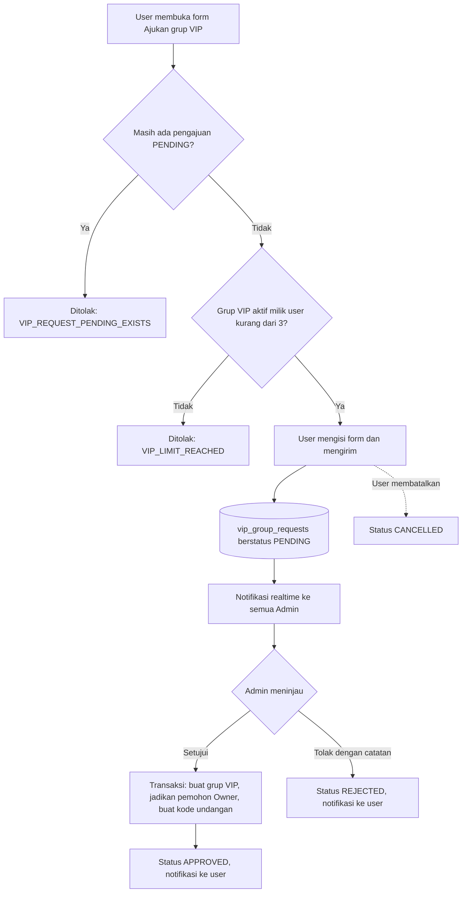
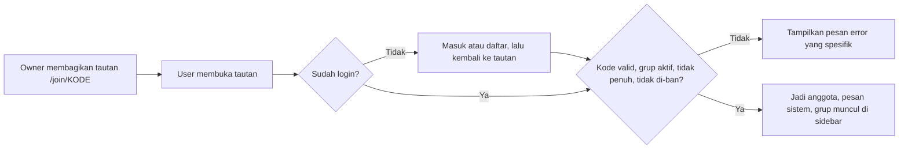

# PRD — RCTapps (Aplikasi Chat Grup Realtime)

> **Nama produk "RCTapps" hanyalah nama sementara (working title).** Ganti sesuai kebutuhan.
> Dokumen terkait: [Design.md](./Design.md) · [rules.md](./rules.md) · [architecture.md](./architecture.md) · [schema.md](./schema.md)

| Item | Isi |
|---|---|
| Versi dokumen | 1.0 (draft awal) |
| Status | Siap ditinjau |
| Platform | Web (responsif desktop & mobile browser) |
| Bahasa antarmuka | Bahasa Indonesia (default), struktur siap i18n |
| Struktur repo | Monorepo — `apps/frontend` dan `apps/backend` terpisah |

---

## 1. Ringkasan

RCTapps adalah aplikasi chat berbasis web untuk **percakapan grup secara realtime**. Ada dua jenis peran utama:

- **Admin** — mengelola seluruh grup, anggota, pengguna, dan meninjau pengajuan grup VIP.
- **User (pengguna)** — bergabung ke grup publik, mengobrol, bergabung ke grup VIP lewat kode undangan, dan dapat **mengajukan pembuatan grup VIP** yang harus disetujui Admin.

Ada dua jenis grup:

| Jenis | Siapa yang membuat | Cara bergabung | Terlihat di halaman Jelajah |
|---|---|---|---|
| **Publik** | Admin | Klik "Gabung" | Ya |
| **VIP** | Admin, atau User melalui pengajuan yang disetujui Admin | Kode/tautan undangan dari Owner | Tidak (privat) |

## 2. Latar belakang & masalah

- Komunitas kecil-menengah butuh ruang obrolan yang **cepat, terkurasi, dan bisa dimoderasi** tanpa harus bergantung pada platform pesan besar.
- Pembuatan grup yang bebas tanpa kontrol menimbulkan spam dan grup tak terurus. Karena itu, pembuatan grup eksklusif (VIP) dibuat **berbasis persetujuan Admin**.
- Admin butuh satu tempat untuk melihat, mengatur, dan mengaudit semua grup serta anggotanya.

## 3. Tujuan & metrik keberhasilan

### 3.1 Tujuan produk

1. Pengguna dapat mengobrol di grup dengan pengalaman **realtime yang terasa instan** dan andal (termasuk saat koneksi putus-nyambung).
2. Admin dapat **mengelola grup dan menyetujui/menolak pengajuan VIP** dalam beberapa klik.
3. Pengguna dapat **mengajukan grup VIP** dan memantau statusnya secara transparan.
4. Fondasi teknis rapi dan siap dikembangkan (monorepo, kontrak API jelas, siap scale horizontal).

### 3.2 Metrik (target MVP)

| Metrik | Target |
|---|---|
| Latensi pengiriman pesan (server menerima → penerima di grup yang sama menerima), p95 | < 300 ms (satu region) |
| Pesan terkirim sukses (tanpa retry manual) | ≥ 99,5% |
| Koneksi bersamaan yang didukung per instance backend | ≥ 1.000 |
| Waktu median Admin meninjau pengajuan VIP | < 24 jam |
| Error rate API (5xx) | < 1% |
| Time-to-first-message pengguna baru (daftar → kirim pesan pertama) | < 2 menit |

## 4. Non-goals (di luar cakupan MVP)

Hal-hal berikut **sengaja tidak dikerjakan** pada rilis pertama:

- Chat 1-on-1 / direct message (DM).
- Panggilan suara/video, screen sharing.
- Enkripsi end-to-end.
- Aplikasi native (iOS/Android) — MVP hanya web responsif.
- Pembayaran/langganan untuk VIP (VIP di sini = grup eksklusif berbasis persetujuan, bukan produk berbayar).
- Bot, integrasi pihak ketiga, webhook.
- Pencarian isi pesan (full-text search).
- Login sosial (Google/GitHub) — dipertimbangkan Fase 2.

## 5. Persona & peran

| Peran | Cakupan | Deskripsi |
|---|---|---|
| **Tamu** | Global | Belum login. Hanya bisa membuka halaman Masuk/Daftar. |
| **User** | Global (`role = USER`) | Pengguna terdaftar. Bisa gabung grup, chat, ajukan VIP. |
| **Admin** | Global (`role = ADMIN`) | Mengelola seluruh platform. Akun Admin **tidak** dibuat lewat pendaftaran publik (di-seed / diangkat oleh Admin lain). |
| **Owner** | Per grup VIP (`group_role = OWNER`) | User yang pengajuannya disetujui; mengelola grup VIP miliknya. |
| **Moderator** | Per grup (`group_role = MODERATOR`) | Anggota yang diberi hak moderasi pesan/anggota oleh Owner/Admin. |

### 5.1 Matriks hak akses

✅ = boleh · ❌ = tidak boleh · ◐ = dengan syarat (lihat catatan)

| Aksi | Tamu | User | Moderator | Owner VIP | Admin |
|---|:-:|:-:|:-:|:-:|:-:|
| Daftar & masuk | ✅ | — | — | — | — |
| Melihat halaman Jelajah (grup publik) | ❌ | ✅ | ✅ | ✅ | ✅ |
| Gabung / keluar grup publik | ❌ | ✅ | ✅ | ✅ | ✅ |
| Gabung grup VIP via kode undangan | ❌ | ✅ | ✅ | ✅ | ✅ |
| Baca & kirim pesan di grup yang diikuti | ❌ | ✅ | ✅ | ✅ | ◐ ¹ |
| Edit (≤ 15 menit) / hapus pesan sendiri | ❌ | ✅ | ✅ | ✅ | ✅ |
| Hapus pesan milik orang lain | ❌ | ❌ | ✅ | ✅ | ✅ |
| Kick / ban anggota | ❌ | ❌ | ◐ ² | ✅ | ✅ |
| Ubah peran anggota (Moderator ↔ Member) | ❌ | ❌ | ❌ | ✅ | ✅ |
| Ubah info grup (nama, deskripsi, avatar) | ❌ | ❌ | ❌ | ✅ | ✅ |
| Regenerate kode undangan VIP | ❌ | ❌ | ❌ | ✅ | ✅ |
| Ajukan pembuatan grup VIP | ❌ | ✅ | ✅ | ✅ | ❌ ³ |
| Buat grup Publik/VIP secara langsung | ❌ | ❌ | ❌ | ❌ | ✅ |
| Arsipkan / pulihkan / hapus grup | ❌ | ❌ | ❌ | ❌ | ✅ |
| Tinjau pengajuan VIP (setujui/tolak) | ❌ | ❌ | ❌ | ❌ | ✅ |
| Kelola pengguna (suspend, ubah role global) | ❌ | ❌ | ❌ | ❌ | ✅ |
| Lihat audit log | ❌ | ❌ | ❌ | ❌ | ✅ |

¹ Admin dapat mengobrol jika ia bergabung sebagai anggota. Mode pantau read-only tanpa bergabung berstatus *Could* (ADM-08).
² Moderator hanya boleh kick/ban **Member biasa**, tidak boleh terhadap Moderator lain atau Owner.
³ Admin langsung membuat grup, tidak perlu pengajuan.

---

## 6. Ruang lingkup & prioritas (MoSCoW)

| Prioritas | Arti |
|---|---|
| **Must** | Wajib ada di MVP |
| **Should** | Penting, dikerjakan bila waktu cukup (target rilis 1.1) |
| **Could** | Nilai tambah, kandidat Fase 2 |
| **Won't** | Tidak dikerjakan sekarang (lihat Non-goals) |

---

## 7. Kebutuhan fungsional (User Stories & Acceptance Criteria)

### Epic A — Autentikasi & profil

| ID | Prioritas | User story | Acceptance criteria |
|---|---|---|---|
| AUTH-01 | Must | Sebagai tamu, saya ingin **mendaftar** dengan email, username, dan password. | Email & username unik (tidak peka huruf besar/kecil). Username 3–20 karakter `[a-z0-9_]`. Password ≥ 8 karakter. Setelah sukses, otomatis masuk dengan role `USER`. Pesan error menyebutkan kolom yang salah. |
| AUTH-02 | Must | Sebagai user, saya ingin **masuk dan keluar**. | Kredensial salah → pesan generik ("Email atau password salah"). Akun `SUSPENDED` ditolak dengan pesan yang jelas. Sesi bertahan hingga 30 hari (refresh token berputar). Keluar mencabut refresh token. |
| AUTH-03 | Must | Sebagai user, saya ingin **mengubah profil** (nama tampilan, avatar). | Nama tampilan 1–40 karakter. Avatar gambar ≤ 2 MB (jpeg/png/webp). Perubahan tampil realtime bagi anggota grup. |
| AUTH-04 | Should | Sebagai user, saya ingin **mengganti password**. | Wajib memasukkan password lama. Semua sesi lain dicabut setelah berhasil. |
| AUTH-05 | Should | Sebagai user, saya ingin **reset password lewat email**. | Tautan sekali pakai, kedaluwarsa 30 menit. |
| AUTH-06 | Could | Sebagai user, saya ingin **verifikasi email**. | Akun tanpa verifikasi tetap dapat memakai aplikasi, dengan banner pengingat. |

### Epic B — Grup, penemuan, dan keanggotaan

| ID | Prioritas | User story | Acceptance criteria |
|---|---|---|---|
| GRP-01 | Must | Sebagai user, saya ingin **menjelajah dan mencari grup publik**. | Daftar menampilkan nama, deskripsi, jumlah anggota. Pencarian berdasarkan nama. Pagination kursor. Grup VIP dan grup yang diarsipkan tidak muncul. |
| GRP-02 | Must | Sebagai user, saya ingin **bergabung ke grup publik** dengan satu klik. | Setelah bergabung, grup muncul di sidebar dan pesan sistem "X bergabung" dikirim. Gagal jika grup penuh (`GROUP_FULL`) atau user di-ban dari grup itu (`BANNED_FROM_GROUP`). |
| GRP-03 | Must | Sebagai user, saya ingin **keluar dari grup**. | Riwayat tidak lagi dapat diakses. Owner VIP tidak bisa keluar sebelum menyerahkan kepemilikan atau grup diarsipkan Admin. |
| GRP-04 | Must | Sebagai user, saya ingin **melihat daftar grup saya** di sidebar. | Menampilkan avatar, nama, cuplikan pesan terakhir, waktu, badge belum dibaca. Urut berdasarkan aktivitas terakhir. Update realtime. |
| GRP-05 | Must | Sebagai user, saya ingin **bergabung ke grup VIP dengan kode/tautan undangan**. | Kode tidak valid → `INVALID_INVITE_CODE`. Kode yang di-regenerate membuat kode lama tidak berlaku. Batas anggota tetap dihormati. |
| GRP-06 | Should | Sebagai user, saya ingin **membisukan notifikasi** grup tertentu. | Badge belum dibaca tetap tampil, tetapi tanpa notifikasi suara/browser. |
| GRP-07 | Should | Sebagai user, saya ingin **melihat daftar anggota** dan status online mereka. | Diurutkan: Owner, Moderator, lalu Member; online lebih dulu. |

### Epic C — Chat realtime

| ID | Prioritas | User story | Acceptance criteria |
|---|---|---|---|
| CHT-01 | Must | Sebagai anggota, saya ingin **mengirim & menerima pesan teks realtime**. | Pesan 1–4.000 karakter. Anggota lain menerima tanpa refresh. Urutan pesan konsisten. Nonanggota tidak bisa menerima/mengirim. |
| CHT-02 | Must | Sebagai anggota, saya ingin **memuat riwayat pesan** dengan scroll ke atas. | 50 pesan per halaman (kursor). Posisi scroll dipertahankan saat riwayat lama dimuat. |
| CHT-03 | Must | Sebagai anggota, saya ingin **status pengiriman** yang jelas. | Pesan tampil langsung (optimistic) berstatus *mengirim* → *terkirim* atau *gagal* dengan tombol **Kirim ulang**. Kirim ulang tidak menggandakan pesan (idempoten via `clientMessageId`). |
| CHT-04 | Must | Sebagai anggota, saya ingin melihat **indikator mengetik**. | "Rani sedang mengetik…" / "3 orang sedang mengetik…". Hilang otomatis setelah 5 detik tanpa aktivitas. |
| CHT-05 | Must | Sebagai anggota, saya ingin melihat **status online** anggota. | Indikator online/offline; diperbarui realtime (grup ≤ 500 anggota). |
| CHT-06 | Must | Sebagai anggota, saya ingin **penanda pesan belum dibaca**. | Badge jumlah di sidebar, pembatas "Pesan baru" di dalam chat. Dianggap terbaca saat grup terbuka dan tab aktif. |
| CHT-07 | Must | Sebagai pengirim, saya ingin **mengedit dan menghapus pesan saya**. | Edit hanya dalam 15 menit dan diberi label "diedit". Hapus → tampil "Pesan ini telah dihapus". Perubahan tersinkron realtime. |
| CHT-08 | Should | Sebagai anggota, saya ingin **membalas pesan tertentu**. | Balasan menampilkan kutipan pesan asal; klik kutipan melompat ke pesan asal (jika sudah dimuat). |
| CHT-09 | Should | Sebagai anggota, saya ingin **mengirim gambar**. | jpeg/png/webp/gif ≤ 5 MB. Pratinjau sebelum kirim. Progress unggah terlihat. |
| CHT-10 | Should | Sebagai anggota, saya ingin **menyebut (mention) anggota** dengan `@username`. | Autocomplete anggota grup. Yang disebut menerima notifikasi. |
| CHT-11 | Could | Sebagai anggota, saya ingin **mengirim dokumen** (pdf, docx, xlsx). | Batas 10 MB, tipe di-whitelist. |
| CHT-12 | Could | Sebagai anggota, saya ingin **memberi reaksi emoji**. | — |
| CHT-13 | Must | Sebagai anggota, saya ingin **tersambung ulang otomatis** saat koneksi putus. | Banner status koneksi. Setelah tersambung, pesan yang terlewat diambil otomatis; tidak ada pesan ganda atau hilang. |
| CHT-14 | Must | Sebagai Moderator/Owner/Admin, saya ingin **menghapus pesan anggota lain**. | Pesan diganti "Pesan dihapus oleh moderator". Tindakan tercatat di audit log. |

### Epic D — Pengajuan grup VIP (User)

| ID | Prioritas | User story | Acceptance criteria |
|---|---|---|---|
| VIP-01 | Must | Sebagai user, saya ingin **mengajukan pembuatan grup VIP**. | Form: nama grup (3–50), deskripsi (≤ 500), tujuan grup (≤ 1.000), perkiraan jumlah anggota (2–1.000). Status awal `PENDING`. Admin dinotifikasi. |
| VIP-02 | Must | Sebagai user, saya ingin **memantau status pengajuan**. | Halaman "Pengajuan saya" menampilkan status `PENDING`/`APPROVED`/`REJECTED`/`CANCELLED`, tanggal, dan catatan Admin. |
| VIP-03 | Must | Sebagai user, saya ingin **membatalkan pengajuan** yang masih pending. | Hanya saat `PENDING`. Status menjadi `CANCELLED`. |
| VIP-04 | Must | Sebagai user, saya ingin **otomatis menjadi Owner** saat pengajuan disetujui. | Grup VIP terbentuk, saya menjadi Owner & anggota, kode undangan dibuat, dan saya menerima notifikasi realtime berisi tautan ke grup. |
| VIP-05 | Must | Sebagai Owner VIP, saya ingin **mengelola grup saya**. | Bagikan/regenerate kode undangan, ubah info grup, kick/ban anggota, angkat/turunkan Moderator. |
| VIP-06 | Must | Sebagai user, saya ingin **diberi tahu realtime** saat pengajuan diproses. | Notifikasi in-app muncul segera (toast + bell); status di halaman pengajuan ikut ter-update. |
| VIP-07 | Must | Sebagai sistem, saya menegakkan **batas pengajuan**. | Maks. 1 pengajuan `PENDING` per user (`VIP_REQUEST_PENDING_EXISTS`); maks. 3 grup VIP aktif yang dimiliki per user (`VIP_LIMIT_REACHED`); jeda ajukan ulang 24 jam setelah `REJECTED`. Semua konfigurabel. |

### Epic E — Panel Admin

| ID | Prioritas | User story | Acceptance criteria |
|---|---|---|---|
| ADM-01 | Must | Sebagai Admin, saya ingin **dashboard ringkas**. | Menampilkan total user, user online, total grup (publik/VIP), pengajuan VIP pending, pesan 24 jam terakhir. |
| ADM-02 | Must | Sebagai Admin, saya ingin **membuat, mengubah, mengarsipkan, memulihkan, dan menghapus grup**. | Grup diarsipkan → read-only untuk anggota. Hapus bersifat *soft delete* dan meminta konfirmasi mengetik nama grup. |
| ADM-03 | Must | Sebagai Admin, saya ingin **mengelola anggota grup**. | Lihat anggota, kick, ban/unban, ubah peran (Member/Moderator). Anggota yang dikeluarkan menerima notifikasi dan langsung kehilangan akses (termasuk koneksi socket). |
| ADM-04 | Must | Sebagai Admin, saya ingin **meninjau pengajuan VIP**. | Daftar difilter menurut status. **Setujui** (boleh mengubah batas anggota) atau **Tolak** (catatan wajib ≥ 10 karakter). Pemrosesan atomik: grup terbentuk hanya jika status berubah ke `APPROVED`. Tidak bisa diproses dua kali. |
| ADM-05 | Must | Sebagai Admin, saya ingin **mengelola pengguna**. | Cari user; suspend/aktifkan; ubah role global. User yang di-suspend langsung diputus dari socket dan sesinya dicabut. Admin tidak dapat menurunkan/suspend dirinya sendiri. |
| ADM-06 | Must | Sebagai Admin, saya ingin **audit log**. | Semua aksi admin/moderasi tercatat (siapa, apa, target, kapan, IP). Dapat difilter. Tidak bisa diubah/dihapus dari UI. |
| ADM-07 | Should | Sebagai Admin, saya ingin **menghapus pesan mana pun** dari grup mana pun. | Sesuai CHT-14. |
| ADM-08 | Could | Sebagai Admin, saya ingin **memantau grup secara read-only** tanpa bergabung. | Tidak menambah `member_count`; tercatat di audit log. |
| ADM-09 | Should | Sebagai Admin, saya ingin **mengirim pengumuman** ke grup. | Muncul sebagai pesan `SYSTEM`. |

### Epic F — Notifikasi

| ID | Prioritas | User story | Acceptance criteria |
|---|---|---|---|
| NTF-01 | Must | Sebagai user, saya ingin **notifikasi in-app** (ikon lonceng). | Jenis: pengajuan VIP disetujui/ditolak, dikeluarkan dari grup, mention. Badge jumlah belum dibaca, tandai sudah dibaca, realtime. Admin juga menerima "pengajuan VIP baru". |
| NTF-02 | Should | Sebagai user, saya ingin **notifikasi browser** saat tab tidak aktif. | Memakai Web Notifications API setelah izin diberikan; menghormati mute grup. |
| NTF-03 | Could | Sebagai user, saya ingin **notifikasi email** untuk hasil pengajuan VIP. | — |

---

## 8. Alur utama

### 8.1 Pengajuan grup VIP

### 8.2 Bergabung ke grup VIP

---

## 9. Aturan bisnis & konfigurasi

Nilai berikut **dikonfigurasi lewat environment/konstanta di `packages/shared`**, bukan di-hardcode di banyak tempat.

| Aturan | Nilai default |
|---|---|
| Panjang pesan | 1–4.000 karakter |
| Rate limit kirim pesan | 10 pesan / 10 detik per user |
| Batas edit pesan | 15 menit sejak dikirim |
| Batas anggota grup Publik | 500 (Admin dapat mengubah) |
| Batas anggota grup VIP | 100 default, maksimum 1.000 (Admin menetapkan saat approve) |
| Pengajuan VIP `PENDING` per user | 1 |
| Grup VIP aktif dimiliki per user | 3 |
| Jeda ajukan ulang setelah ditolak | 24 jam |
| Ukuran gambar pesan | ≤ 5 MB |
| Ukuran avatar | ≤ 2 MB |
| Username | 3–20 karakter, `[a-z0-9_]` |
| Nama grup / deskripsi | 3–50 / ≤ 500 karakter |
| Masa berlaku access token / refresh token | 15 menit / 30 hari |
| Rate limit login | 5 percobaan / menit per IP + email |

---

## 10. Kebutuhan non-fungsional

| Kategori | Kebutuhan |
|---|---|
| **Performa** | p95 pengiriman pesan < 300 ms; muat 50 pesan pertama < 500 ms; First Contentful Paint halaman chat < 2 dtk pada 4G. Daftar pesan memakai virtualisasi. |
| **Skalabilitas** | Backend stateless; Socket.IO dengan Redis adapter agar bisa scale horizontal. Target awal 1.000 koneksi/instance. |
| **Keandalan** | Pengiriman pesan idempoten; reconnect otomatis dengan sinkronisasi pesan terlewat; uptime ≥ 99,5%. |
| **Keamanan** | Password di-hash Argon2id; JWT berumur pendek + refresh token berputar; otorisasi diperiksa **di server** untuk setiap aksi REST maupun event socket; rate limiting; validasi input; proteksi XSS/CSRF; unggahan divalidasi. Detail di [architecture.md](./architecture.md). |
| **Privasi** | Isi pesan hanya dapat diakses anggota aktif grup. Pesan yang dihapus dikosongkan isinya. Anggota yang keluar/dikeluarkan kehilangan akses riwayat. |
| **Aksesibilitas** | Target WCAG 2.1 AA: navigasi keyboard penuh, fokus terlihat, kontras memadai, `aria-live` untuk pesan baru, hormati `prefers-reduced-motion`. |
| **Kompatibilitas** | Dua versi terbaru Chrome, Edge, Firefox, Safari (desktop & mobile). |
| **Observabilitas** | Log terstruktur (JSON) dengan `requestId`, endpoint health-check, metrik koneksi socket & latensi. |
| **Maintainability** | TypeScript strict, kontrak API/WS terdokumentasi, cakupan tes pada alur kritis (lihat [rules.md](./rules.md)). |
| **Lokalisasi** | Semua teks UI dari satu kamus (default `id-ID`); tanggal/waktu memakai zona waktu perangkat pengguna. |

---

## 11. Daftar halaman

| Area | Halaman | Rute (FE) |
|---|---|---|
| Publik | Masuk | `/login` |
| Publik | Daftar | `/register` |
| Publik/Auth | Gabung via kode | `/join/[code]` |
| User | Chat (sidebar + percakapan) | `/chat`, `/chat/[groupId]` |
| User | Jelajah grup publik | `/discover` |
| User | Ajukan grup VIP | `/vip/new` |
| User | Pengajuan saya | `/vip` |
| User | Pengaturan profil & akun | `/settings` |
| Admin | Dashboard | `/admin` |
| Admin | Kelola grup (daftar, detail, anggota) | `/admin/groups`, `/admin/groups/[id]` |
| Admin | Pengajuan VIP | `/admin/vip-requests` |
| Admin | Kelola pengguna | `/admin/users` |
| Admin | Audit log | `/admin/audit-logs` |

Spesifikasi visual dan wireframe ada di [Design.md](./Design.md).

---

## 12. Milestone (estimasi untuk 2–3 developer)

| Milestone | Cakupan | Estimasi |
|---|---|---|
| **M0 — Fondasi** | Monorepo, CI, Docker Compose (Postgres, Redis, MinIO), skema DB awal, design tokens | 1 minggu |
| **M1 — Auth & profil** | AUTH-01..03, layout dasar, seed Admin | 1 minggu |
| **M2 — Grup & chat inti** | GRP-01..05, CHT-01..07, CHT-13 | 3 minggu |
| **M3 — Alur VIP** | VIP-01..07, NTF-01, Owner tools | 2 minggu |
| **M4 — Panel Admin** | ADM-01..06 | 2 minggu |
| **M5 — Polish & hardening** | Fitur *Should* terpilih, uji beban, keamanan, aksesibilitas, dokumentasi | 1–2 minggu |
| **Rilis MVP** | Deploy produksi, monitoring | — |

## 13. Risiko & mitigasi

| Risiko | Dampak | Mitigasi |
|---|---|---|
| Pesan ganda/hilang saat koneksi tidak stabil | Pengalaman buruk | `clientMessageId` idempoten, ack dari server, sinkronisasi via `after` cursor saat reconnect |
| Otorisasi socket terlewat (kebocoran pesan grup) | Kritis | Semua handler socket melewati guard keanggotaan; tes otorisasi wajib; akses dicabut langsung saat kick/ban |
| Race condition batas anggota / persetujuan ganda | Data tidak konsisten | Transaksi DB + row lock pada grup/pengajuan; constraint unik parsial |
| Spam / penyalahgunaan | Merusak komunitas | Rate limit, moderasi, ban, audit log |
| Beban socket melonjak | Lambat/putus | Redis adapter, uji beban, batas presence untuk grup besar |
| Cakupan melebar | Jadwal molor | Disiplin MoSCoW; fitur *Should/Could* tidak menghalangi rilis |

## 14. Asumsi & pertanyaan terbuka

**Asumsi**

- Pendaftaran terbuka untuk umum (tanpa undangan) dengan email + password.
- FE dan BE di-deploy pada *site* yang sama (mis. `app.contoh.id` dan `api.contoh.id`) agar cookie refresh token bekerja dengan `SameSite=Lax`.
- Satu region deployment untuk MVP.

**Perlu dikonfirmasi**

1. Apakah Owner VIP boleh **menyerahkan kepemilikan** ke anggota lain (usulan: ya, Fase 2)?
2. Apakah grup VIP perlu **persetujuan Owner** untuk anggota yang masuk via kode (usulan MVP: tidak, kode cukup)?
3. Apakah Admin perlu **mode pantau** grup VIP privat (isu privasi)? Bila ya, harus transparan dan tercatat di audit log.
4. Perlu **verifikasi email** sejak MVP atau cukup Fase 2?
5. Kebijakan **retensi pesan** (selamanya vs. dihapus setelah N bulan)?

## 15. Glosarium

| Istilah | Arti |
|---|---|
| Grup Publik | Grup terbuka yang muncul di Jelajah dan bisa dimasuki siapa saja yang sudah login |
| Grup VIP | Grup privat, hanya bisa dimasuki lewat kode undangan; dibuat oleh Admin atau lewat pengajuan yang disetujui |
| Owner | Pemilik grup VIP (hak tertinggi di grup itu) |
| Moderator | Anggota dengan hak moderasi di satu grup |
| Presence | Status online/offline pengguna |
| Ack | Konfirmasi dari server bahwa event socket berhasil diproses |
| Idempoten | Aksi yang diulang tidak menghasilkan efek ganda |
