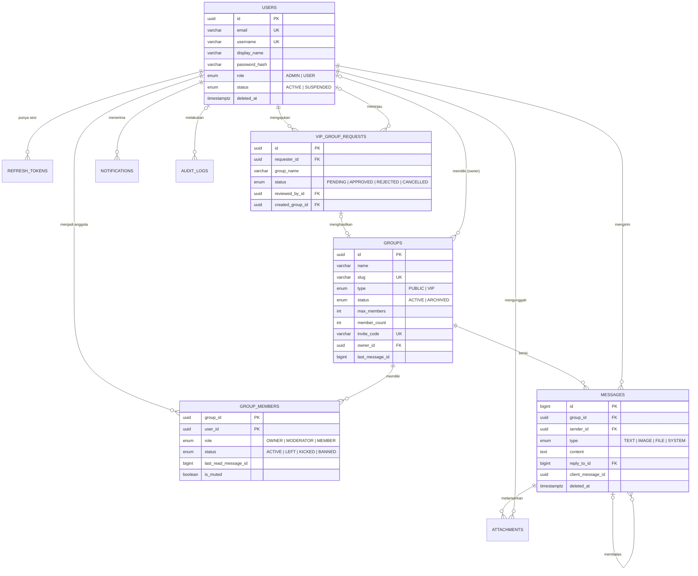

# schema — Skema Data Kumpul

> Dokumen terkait: [PRD.md](./PRD.md) · [Design.md](./Design.md) · [rules.md](./rules.md) · [architecture.md](./architecture.md)
> **Database:** PostgreSQL 16+ · **ORM:** Prisma · **Cache/ephemeral:** Redis 7+
> Sumber kebenaran implementasi adalah `apps/backend/prisma/schema.prisma` + berkas migrasi. Dokumen ini harus diperbarui pada PR yang mengubah skema.

---

## 1. Konvensi

| Aspek | Aturan |
|---|---|
| Nama tabel/kolom | `snake_case`, tabel **jamak** (`group_members`); di Prisma: model `PascalCase` + `@@map` / `@map` |
| Primary key | `UUID` (`gen_random_uuid()`) untuk sebagian besar tabel; `BIGINT` (BIGSERIAL) untuk `messages` dan `audit_logs` (urutan monoton) |
| Waktu | `TIMESTAMPTZ(6)`, disimpan **UTC**; kolom standar `created_at`, `updated_at` (bila dapat diubah), `deleted_at` (soft delete) |
| Foreign key | `<entitas>_id`, selalu punya indeks pendukung |
| Nama indeks/constraint | `ix_` (indeks), `uq_` (unik), `ck_` (check) — untuk yang dibuat lewat SQL manual |
| Soft delete | `users`, `groups` (kolom `deleted_at`). Pesan memakai `deleted_at` + pengosongan isi |
| Enum | Enum PostgreSQL (dibuat oleh Prisma), nilai `UPPER_SNAKE_CASE`, dicerminkan di `packages/shared` |
| ID di JSON | `BIGINT` diserialisasi sebagai **string** |

---

## 2. ERD



---

## 3. Enum

| Enum | Nilai |
|---|---|
| `Role` | `ADMIN`, `USER` |
| `UserStatus` | `ACTIVE`, `SUSPENDED` |
| `GroupType` | `PUBLIC`, `VIP` |
| `GroupStatus` | `ACTIVE`, `ARCHIVED` |
| `GroupRole` | `OWNER`, `MODERATOR`, `MEMBER` |
| `MemberStatus` | `ACTIVE`, `LEFT`, `KICKED`, `BANNED` |
| `MessageType` | `TEXT`, `IMAGE`, `FILE`, `SYSTEM` |
| `VipRequestStatus` | `PENDING`, `APPROVED`, `REJECTED`, `CANCELLED` |
| `NotificationType` | `VIP_REQUEST_SUBMITTED`, `VIP_REQUEST_APPROVED`, `VIP_REQUEST_REJECTED`, `REMOVED_FROM_GROUP`, `MENTION`, `SYSTEM` |
| `AttachmentPurpose` | `MESSAGE`, `USER_AVATAR`, `GROUP_AVATAR` |
| `AttachmentStatus` | `PENDING` (URL unggah diterbitkan), `READY` (terverifikasi) |

---

## 4. Definisi tabel

### 4.1 `users`

| Kolom | Tipe | Null | Catatan |
|---|---|:-:|---|
| `id` | uuid | — | PK |
| `email` | varchar(254) | — | **Unik**, disimpan huruf kecil (CHECK) |
| `username` | varchar(20) | — | **Unik**, `^[a-z0-9_]{3,20}$` (CHECK) |
| `display_name` | varchar(40) | — | Nama tampilan |
| `password_hash` | text | — | Argon2id |
| `avatar_url` | text | ✔ | Diisi server dari lampiran `USER_AVATAR` |
| `role` | `Role` | — | Default `USER` |
| `status` | `UserStatus` | — | Default `ACTIVE` |
| `email_verified_at` | timestamptz | ✔ | Fase 2 |
| `last_seen_at` | timestamptz | ✔ | Diperbarui saat benar-benar offline |
| `created_at` / `updated_at` | timestamptz | — | |
| `deleted_at` | timestamptz | ✔ | Soft delete + anonimisasi (lihat §8) |

Indeks: `uq(email)`, `uq(username)`, `ix(status)`.

### 4.2 `refresh_tokens`

| Kolom | Tipe | Null | Catatan |
|---|---|:-:|---|
| `id` | uuid | — | PK |
| `user_id` | uuid | — | FK → `users` (CASCADE) |
| `family_id` | uuid | — | Kelompok rotasi; dicabut seluruhnya bila terjadi *reuse* |
| `token_hash` | varchar(64) | — | **Unik**; SHA-256 dari token acak (token asli tidak disimpan) |
| `user_agent` / `ip` | varchar | ✔ | Untuk daftar perangkat/keamanan |
| `expires_at` | timestamptz | — | Default now + 30 hari |
| `revoked_at` | timestamptz | ✔ | |
| `replaced_by_id` | uuid | ✔ | Rantai rotasi |
| `created_at` | timestamptz | — | |

Indeks: `uq(token_hash)`, `ix(user_id)`, `ix(family_id)`, `ix(expires_at)` (pembersihan).

### 4.3 `groups`

| Kolom | Tipe | Null | Catatan |
|---|---|:-:|---|
| `id` | uuid | — | PK |
| `name` | varchar(50) | — | 3–50 karakter |
| `slug` | varchar(64) | — | **Unik**; dari nama + akhiran acak |
| `description` | varchar(500) | ✔ | |
| `avatar_url` | text | ✔ | |
| `type` | `GroupType` | — | Default `PUBLIC` |
| `status` | `GroupStatus` | — | `ARCHIVED` → read-only |
| `max_members` | int | — | 2–1.000; default 500 (publik) / 100 (VIP) |
| `member_count` | int | — | **Denormalisasi** anggota `ACTIVE`; diubah dalam transaksi join/leave/kick/ban |
| `invite_code` | varchar(16) | ✔ | **Unik**; wajib untuk `VIP`; acak base62 |
| `owner_id` | uuid | ✔ | FK → `users` (RESTRICT). **Wajib** untuk `VIP` (CHECK); `NULL` untuk publik buatan Admin |
| `created_by_id` | uuid | — | FK → `users`. Selalu **Admin** yang membuat grup atau yang menyetujui pengajuan VIP (pemohon tercatat sebagai `owner_id`) |
| `last_message_id` | bigint | ✔ | **Denormalisasi** (tanpa FK) untuk pratinjau sidebar; diperbarui bersama INSERT pesan |
| `last_message_at` | timestamptz | ✔ | Untuk pengurutan aktivitas |
| `archived_at` | timestamptz | ✔ | |
| `created_at` / `updated_at` / `deleted_at` | timestamptz | — / — / ✔ | |

Indeks: `uq(slug)`, `uq(invite_code)`, `ix(type, status, deleted_at)`, `ix(owner_id)`, `ix(last_message_at DESC)`; SQL manual: trigram pada `lower(name)` (pencarian Jelajah), indeks parsial grup VIP aktif per owner.

### 4.4 `group_members`

Tabel penghubung dengan **PK komposit** `(group_id, user_id)`; satu baris per pasangan (riwayat status cukup lewat kolom, bukan baris baru).

| Kolom | Tipe | Null | Catatan |
|---|---|:-:|---|
| `group_id` | uuid | — | PK, FK → `groups` (CASCADE) |
| `user_id` | uuid | — | PK, FK → `users` (CASCADE) |
| `role` | `GroupRole` | — | Default `MEMBER`. `OWNER` hanya untuk grup VIP |
| `status` | `MemberStatus` | — | Default `ACTIVE` |
| `is_muted` | boolean | — | Default `false` |
| `last_read_message_id` | bigint | ✔ | Kursor baca; hanya boleh **maju** |
| `banned_reason` | varchar(200) | ✔ | |
| `joined_at` | timestamptz | — | Diperbarui saat bergabung ulang |
| `left_at` | timestamptz | ✔ | |

Indeks: PK, `ix(user_id, status)` (grup saya), `ix(group_id, status, role)` (daftar anggota), unik parsial **satu Owner aktif per grup**.

**Mesin status keanggotaan**

| Dari | Ke | Pemicu | Catatan |
|---|---|---|---|
| — | `ACTIVE` | Gabung publik / gabung via kode / approval VIP (Owner) | `member_count += 1`; set `last_read_message_id = groups.last_message_id` agar riwayat lama tidak dihitung "belum dibaca" |
| `ACTIVE` | `LEFT` | Keluar | `left_at` diisi, `member_count -= 1` |
| `LEFT` / `KICKED` | `ACTIVE` | Gabung ulang | Grup VIP tetap butuh kode undangan yang valid |
| `ACTIVE` | `KICKED` | Kick | Boleh bergabung ulang |
| `ACTIVE` / `LEFT` / `KICKED` | `BANNED` | Ban | Tidak bisa bergabung (`BANNED_FROM_GROUP`) |
| `BANNED` | `LEFT` | Unban | Selanjutnya boleh bergabung lagi |

> **Keputusan MVP:** anggota `ACTIVE` dapat membaca **seluruh riwayat** grup. Pembatasan riwayat sejak `joined_at` dapat ditambahkan kelak (lihat PRD §14).

### 4.5 `messages`

| Kolom | Tipe | Null | Catatan |
|---|---|:-:|---|
| `id` | bigint | — | PK (BIGSERIAL), monoton → dipakai sebagai **kursor** |
| `group_id` | uuid | — | FK → `groups` (CASCADE) |
| `sender_id` | uuid | ✔ | FK → `users` (SET NULL); `NULL` untuk `SYSTEM` |
| `type` | `MessageType` | — | Default `TEXT` |
| `content` | text | ✔ | ≤ 4.000 karakter (CHECK). `NULL` jika dihapus |
| `reply_to_id` | bigint | ✔ | FK → `messages` (SET NULL) |
| `client_message_id` | uuid | ✔ | Idempotensi; **unik bersama `sender_id`** |
| `mentions` | uuid[] | — | Daftar `user_id` yang disebut; default `{}` |
| `metadata` | jsonb | ✔ | Data tambahan pesan sistem (mis. `{ "event": "MEMBER_JOINED", "userId": "…" }`) |
| `edited_at` | timestamptz | ✔ | |
| `deleted_at` | timestamptz | ✔ | Soft delete; `content` dikosongkan |
| `deleted_by_id` | uuid | ✔ | Bila ≠ `sender_id` ⇒ dihapus moderator (`deletedBy: "MODERATOR"`) |
| `created_at` | timestamptz | — | |

Indeks: PK, **`ix(group_id, id DESC)`** (riwayat & unread), `uq(sender_id, client_message_id)` (NULL dianggap berbeda sehingga pesan sistem aman), `ix(reply_to_id)`.

### 4.6 `attachments`

| Kolom | Tipe | Null | Catatan |
|---|---|:-:|---|
| `id` | uuid | — | PK |
| `purpose` | `AttachmentPurpose` | — | |
| `status` | `AttachmentStatus` | — | `PENDING` → `READY` setelah `complete` |
| `uploader_id` | uuid | — | FK → `users` |
| `group_id` | uuid | ✔ | FK → `groups`; terisi untuk `MESSAGE` / `GROUP_AVATAR` |
| `message_id` | bigint | ✔ | FK → `messages` (CASCADE); `NULL` sampai dipakai pesan |
| `storage_key` | text | — | **Unik**; mis. `messages/{groupId}/{uuid}.webp` |
| `mime_type` | varchar(100) | — | Whitelist |
| `size_bytes` | int | — | |
| `width` / `height` | int | ✔ | Untuk gambar |
| `original_name` | varchar(255) | ✔ | Hanya untuk tampilan |
| `created_at` | timestamptz | — | |

Indeks: `uq(storage_key)`, `ix(message_id)`, `ix(status, created_at)` (job pembersihan lampiran yatim > 24 jam), `ix(uploader_id)`.

### 4.7 `vip_group_requests`

| Kolom | Tipe | Null | Catatan |
|---|---|:-:|---|
| `id` | uuid | — | PK |
| `requester_id` | uuid | — | FK → `users` |
| `group_name` | varchar(50) | — | |
| `description` | varchar(500) | ✔ | |
| `purpose` | varchar(1000) | — | Tujuan grup |
| `expected_members` | int | — | 2–1.000 |
| `status` | `VipRequestStatus` | — | Default `PENDING` |
| `reviewed_by_id` | uuid | ✔ | FK → `users` (Admin) |
| `reviewed_at` | timestamptz | ✔ | |
| `review_note` | varchar(500) | ✔ | Wajib (≥ 10 karakter) saat `REJECTED` — divalidasi di aplikasi |
| `approved_max_members` | int | ✔ | Batas anggota yang ditetapkan Admin |
| `created_group_id` | uuid | ✔ | **Unik**, FK → `groups`; terisi saat `APPROVED` |
| `created_at` / `updated_at` | timestamptz | — | |

Indeks: `ix(status, created_at)` (antrian Admin), `ix(requester_id, created_at DESC)` (pengajuan saya), **unik parsial: satu `PENDING` per `requester_id`** (SQL manual, §6).

### 4.8 `notifications`

| Kolom | Tipe | Null | Catatan |
|---|---|:-:|---|
| `id` | uuid | — | PK |
| `user_id` | uuid | — | FK → `users` (CASCADE) |
| `type` | `NotificationType` | — | |
| `title` | varchar(120) | — | |
| `body` | varchar(500) | ✔ | |
| `data` | jsonb | ✔ | Tautan/konteks, mis. `{ "groupId": "…", "requestId": "…" }` |
| `read_at` | timestamptz | ✔ | |
| `created_at` | timestamptz | — | |

Indeks: `ix(user_id, created_at DESC)`; parsial untuk belum dibaca (SQL manual). Retensi: hapus > 90 hari.

### 4.9 `audit_logs`

Append-only (tidak ada `UPDATE`/`DELETE` dari aplikasi).

| Kolom | Tipe | Null | Catatan |
|---|---|:-:|---|
| `id` | bigint | — | PK (BIGSERIAL) |
| `actor_id` | uuid | ✔ | FK → `users` (SET NULL) |
| `action` | varchar(64) | — | Lihat daftar di bawah |
| `target_type` | varchar(32) | — | `user` \| `group` \| `member` \| `message` \| `vip_request` |
| `target_id` | varchar(64) | — | ID target (string agar mendukung UUID & bigint) |
| `metadata` | jsonb | ✔ | Ringkasan perubahan (tanpa data sensitif / isi pesan) |
| `ip` | varchar(45) | ✔ | |
| `user_agent` | varchar(255) | ✔ | |
| `created_at` | timestamptz | — | |

Indeks: `ix(created_at DESC)`, `ix(actor_id, created_at DESC)`, `ix(action, created_at DESC)`, `ix(target_type, target_id)`.

**Nilai `action` resmi:** `user.suspend` · `user.activate` · `user.role_change` · `group.create` · `group.update` · `group.archive` · `group.restore` · `group.delete` · `group.announce` · `member.kick` · `member.ban` · `member.unban` · `member.role_change` · `invite_code.regenerate` · `message.delete_by_moderator` · `vip_request.approve` · `vip_request.reject`.

---

## 5. Prisma schema

```prisma
// apps/backend/prisma/schema.prisma

generator client {
  provider = "prisma-client-js"
}

datasource db {
  provider = "postgresql"
  url      = env("DATABASE_URL")
}

// ───────────── Enums ─────────────
enum Role              { ADMIN USER }
enum UserStatus        { ACTIVE SUSPENDED }
enum GroupType         { PUBLIC VIP }
enum GroupStatus       { ACTIVE ARCHIVED }
enum GroupRole         { OWNER MODERATOR MEMBER }
enum MemberStatus      { ACTIVE LEFT KICKED BANNED }
enum MessageType       { TEXT IMAGE FILE SYSTEM }
enum VipRequestStatus  { PENDING APPROVED REJECTED CANCELLED }
enum AttachmentPurpose { MESSAGE USER_AVATAR GROUP_AVATAR }
enum AttachmentStatus  { PENDING READY }
enum NotificationType {
  VIP_REQUEST_SUBMITTED
  VIP_REQUEST_APPROVED
  VIP_REQUEST_REJECTED
  REMOVED_FROM_GROUP
  MENTION
  SYSTEM
}

// ───────────── Users & sesi ─────────────
model User {
  id              String     @id @default(uuid()) @db.Uuid
  email           String     @unique @db.VarChar(254)
  username        String     @unique @db.VarChar(20)
  displayName     String     @map("display_name") @db.VarChar(40)
  passwordHash    String     @map("password_hash")
  avatarUrl       String?    @map("avatar_url")
  role            Role       @default(USER)
  status          UserStatus @default(ACTIVE)
  emailVerifiedAt DateTime?  @map("email_verified_at") @db.Timestamptz(6)
  lastSeenAt      DateTime?  @map("last_seen_at") @db.Timestamptz(6)
  createdAt       DateTime   @default(now()) @map("created_at") @db.Timestamptz(6)
  updatedAt       DateTime   @updatedAt @map("updated_at") @db.Timestamptz(6)
  deletedAt       DateTime?  @map("deleted_at") @db.Timestamptz(6)

  refreshTokens       RefreshToken[]
  memberships         GroupMember[]
  sentMessages        Message[]         @relation("MessageSender")
  deletedMessages     Message[]         @relation("MessageDeleter")
  ownedGroups         Group[]           @relation("GroupOwner")
  createdGroups       Group[]           @relation("GroupCreator")
  vipRequests         VipGroupRequest[] @relation("VipRequester")
  reviewedVipRequests VipGroupRequest[] @relation("VipReviewer")
  notifications       Notification[]
  attachments         Attachment[]
  auditLogs           AuditLog[]

  @@index([status])
  @@map("users")
}

model RefreshToken {
  id           String    @id @default(uuid()) @db.Uuid
  userId       String    @map("user_id") @db.Uuid
  familyId     String    @map("family_id") @db.Uuid
  tokenHash    String    @unique @map("token_hash") @db.VarChar(64)
  userAgent    String?   @map("user_agent") @db.VarChar(255)
  ip           String?   @db.VarChar(45)
  expiresAt    DateTime  @map("expires_at") @db.Timestamptz(6)
  revokedAt    DateTime? @map("revoked_at") @db.Timestamptz(6)
  replacedById String?   @map("replaced_by_id") @db.Uuid
  createdAt    DateTime  @default(now()) @map("created_at") @db.Timestamptz(6)

  user User @relation(fields: [userId], references: [id], onDelete: Cascade)

  @@index([userId])
  @@index([familyId])
  @@index([expiresAt])
  @@map("refresh_tokens")
}

// ───────────── Grup & keanggotaan ─────────────
model Group {
  id            String      @id @default(uuid()) @db.Uuid
  name          String      @db.VarChar(50)
  slug          String      @unique @db.VarChar(64)
  description   String?     @db.VarChar(500)
  avatarUrl     String?     @map("avatar_url")
  type          GroupType   @default(PUBLIC)
  status        GroupStatus @default(ACTIVE)
  maxMembers    Int         @default(500) @map("max_members")
  memberCount   Int         @default(0) @map("member_count")
  inviteCode    String?     @unique @map("invite_code") @db.VarChar(16)
  ownerId       String?     @map("owner_id") @db.Uuid
  createdById   String      @map("created_by_id") @db.Uuid
  lastMessageId BigInt?     @map("last_message_id") // denormalisasi, tanpa FK
  lastMessageAt DateTime?   @map("last_message_at") @db.Timestamptz(6)
  archivedAt    DateTime?   @map("archived_at") @db.Timestamptz(6)
  createdAt     DateTime    @default(now()) @map("created_at") @db.Timestamptz(6)
  updatedAt     DateTime    @updatedAt @map("updated_at") @db.Timestamptz(6)
  deletedAt     DateTime?   @map("deleted_at") @db.Timestamptz(6)

  owner         User?             @relation("GroupOwner", fields: [ownerId], references: [id], onDelete: Restrict)
  createdBy     User              @relation("GroupCreator", fields: [createdById], references: [id], onDelete: Restrict)
  members       GroupMember[]
  messages      Message[]
  attachments   Attachment[]
  sourceRequest VipGroupRequest?  @relation("RequestCreatedGroup")

  @@index([type, status, deletedAt])
  @@index([ownerId])
  @@index([lastMessageAt(sort: Desc)])
  @@map("groups")
}

model GroupMember {
  groupId           String       @map("group_id") @db.Uuid
  userId            String       @map("user_id") @db.Uuid
  role              GroupRole    @default(MEMBER)
  status            MemberStatus @default(ACTIVE)
  isMuted           Boolean      @default(false) @map("is_muted")
  lastReadMessageId BigInt?      @map("last_read_message_id")
  bannedReason      String?      @map("banned_reason") @db.VarChar(200)
  joinedAt          DateTime     @default(now()) @map("joined_at") @db.Timestamptz(6)
  leftAt            DateTime?    @map("left_at") @db.Timestamptz(6)

  group Group @relation(fields: [groupId], references: [id], onDelete: Cascade)
  user  User  @relation(fields: [userId], references: [id], onDelete: Cascade)

  @@id([groupId, userId])
  @@index([userId, status])
  @@index([groupId, status, role])
  @@map("group_members")
}

// ───────────── Pesan & lampiran ─────────────
model Message {
  id              BigInt      @id @default(autoincrement())
  groupId         String      @map("group_id") @db.Uuid
  senderId        String?     @map("sender_id") @db.Uuid
  type            MessageType @default(TEXT)
  content         String?
  replyToId       BigInt?     @map("reply_to_id")
  clientMessageId String?     @map("client_message_id") @db.Uuid
  mentions        String[]    @default([]) @db.Uuid
  metadata        Json?
  editedAt        DateTime?   @map("edited_at") @db.Timestamptz(6)
  deletedAt       DateTime?   @map("deleted_at") @db.Timestamptz(6)
  deletedById     String?     @map("deleted_by_id") @db.Uuid
  createdAt       DateTime    @default(now()) @map("created_at") @db.Timestamptz(6)

  group       Group        @relation(fields: [groupId], references: [id], onDelete: Cascade)
  sender      User?        @relation("MessageSender", fields: [senderId], references: [id], onDelete: SetNull)
  deletedBy   User?        @relation("MessageDeleter", fields: [deletedById], references: [id], onDelete: SetNull)
  replyTo     Message?     @relation("MessageReply", fields: [replyToId], references: [id], onDelete: SetNull)
  replies     Message[]    @relation("MessageReply")
  attachments Attachment[]

  @@unique([senderId, clientMessageId])
  @@index([groupId, id(sort: Desc)])
  @@index([replyToId])
  @@map("messages")
}

model Attachment {
  id           String            @id @default(uuid()) @db.Uuid
  purpose      AttachmentPurpose
  status       AttachmentStatus  @default(PENDING)
  uploaderId   String            @map("uploader_id") @db.Uuid
  groupId      String?           @map("group_id") @db.Uuid
  messageId    BigInt?           @map("message_id")
  storageKey   String            @unique @map("storage_key")
  mimeType     String            @map("mime_type") @db.VarChar(100)
  sizeBytes    Int               @map("size_bytes")
  width        Int?
  height       Int?
  originalName String?           @map("original_name") @db.VarChar(255)
  createdAt    DateTime          @default(now()) @map("created_at") @db.Timestamptz(6)

  uploader User     @relation(fields: [uploaderId], references: [id], onDelete: Cascade)
  group    Group?   @relation(fields: [groupId], references: [id], onDelete: Cascade)
  message  Message? @relation(fields: [messageId], references: [id], onDelete: Cascade)

  @@index([messageId])
  @@index([uploaderId])
  @@index([status, createdAt])
  @@map("attachments")
}

// ───────────── Pengajuan VIP ─────────────
model VipGroupRequest {
  id                 String           @id @default(uuid()) @db.Uuid
  requesterId        String           @map("requester_id") @db.Uuid
  groupName          String           @map("group_name") @db.VarChar(50)
  description        String?          @db.VarChar(500)
  purpose            String           @db.VarChar(1000)
  expectedMembers    Int              @map("expected_members")
  status             VipRequestStatus @default(PENDING)
  reviewedById       String?          @map("reviewed_by_id") @db.Uuid
  reviewedAt         DateTime?        @map("reviewed_at") @db.Timestamptz(6)
  reviewNote         String?          @map("review_note") @db.VarChar(500)
  approvedMaxMembers Int?             @map("approved_max_members")
  createdGroupId     String?          @unique @map("created_group_id") @db.Uuid
  createdAt          DateTime         @default(now()) @map("created_at") @db.Timestamptz(6)
  updatedAt          DateTime         @updatedAt @map("updated_at") @db.Timestamptz(6)

  requester    User   @relation("VipRequester", fields: [requesterId], references: [id], onDelete: Cascade)
  reviewer     User?  @relation("VipReviewer", fields: [reviewedById], references: [id], onDelete: SetNull)
  createdGroup Group? @relation("RequestCreatedGroup", fields: [createdGroupId], references: [id], onDelete: SetNull)

  @@index([status, createdAt])
  @@index([requesterId, createdAt(sort: Desc)])
  @@map("vip_group_requests")
}

// ───────────── Notifikasi & audit ─────────────
model Notification {
  id        String           @id @default(uuid()) @db.Uuid
  userId    String           @map("user_id") @db.Uuid
  type      NotificationType
  title     String           @db.VarChar(120)
  body      String?          @db.VarChar(500)
  data      Json?
  readAt    DateTime?        @map("read_at") @db.Timestamptz(6)
  createdAt DateTime         @default(now()) @map("created_at") @db.Timestamptz(6)

  user User @relation(fields: [userId], references: [id], onDelete: Cascade)

  @@index([userId, createdAt(sort: Desc)])
  @@map("notifications")
}

model AuditLog {
  id         BigInt   @id @default(autoincrement())
  actorId    String?  @map("actor_id") @db.Uuid
  action     String   @db.VarChar(64)
  targetType String   @map("target_type") @db.VarChar(32)
  targetId   String   @map("target_id") @db.VarChar(64)
  metadata   Json?
  ip         String?  @db.VarChar(45)
  userAgent  String?  @map("user_agent") @db.VarChar(255)
  createdAt  DateTime @default(now()) @map("created_at") @db.Timestamptz(6)

  actor User? @relation(fields: [actorId], references: [id], onDelete: SetNull)

  @@index([createdAt(sort: Desc)])
  @@index([actorId, createdAt(sort: Desc)])
  @@index([action, createdAt(sort: Desc)])
  @@index([targetType, targetId])
  @@map("audit_logs")
}
```

---

## 6. SQL tambahan (migrasi manual)

Prisma belum dapat menyatakan constraint CHECK, indeks parsial, dan ekstensi. Buat migrasi kosong (`prisma migrate dev --create-only --name extra_constraints`) lalu isi dengan SQL berikut:

```sql
-- Ekstensi untuk pencarian nama grup (Jelajah)
CREATE EXTENSION IF NOT EXISTS pg_trgm;

-- ── Integritas data ────────────────────────────────────────────────
ALTER TABLE users
  ADD CONSTRAINT ck_users_email_lower     CHECK (email = lower(email)),
  ADD CONSTRAINT ck_users_username_format CHECK (username ~ '^[a-z0-9_]{3,20}$');

ALTER TABLE groups
  ADD CONSTRAINT ck_groups_max_members  CHECK (max_members BETWEEN 2 AND 1000),
  ADD CONSTRAINT ck_groups_member_count CHECK (member_count >= 0 AND member_count <= max_members),
  ADD CONSTRAINT ck_groups_vip_owner    CHECK (type <> 'VIP' OR owner_id IS NOT NULL),
  ADD CONSTRAINT ck_groups_vip_invite   CHECK (type <> 'VIP' OR invite_code IS NOT NULL);

ALTER TABLE messages
  ADD CONSTRAINT ck_messages_content_len CHECK (content IS NULL OR char_length(content) <= 4000),
  ADD CONSTRAINT ck_messages_text_body   CHECK (type <> 'TEXT' OR deleted_at IS NOT NULL OR content IS NOT NULL);

ALTER TABLE vip_group_requests
  ADD CONSTRAINT ck_vip_expected_members CHECK (expected_members BETWEEN 2 AND 1000);

-- ── Aturan bisnis lewat indeks unik parsial ────────────────────────
-- Maksimal 1 pengajuan PENDING per pemohon
CREATE UNIQUE INDEX uq_vip_requests_one_pending
  ON vip_group_requests (requester_id) WHERE status = 'PENDING';

-- Maksimal 1 Owner aktif per grup
CREATE UNIQUE INDEX uq_group_members_one_owner
  ON group_members (group_id) WHERE role = 'OWNER' AND status = 'ACTIVE';

-- ── Indeks performa ────────────────────────────────────────────────
CREATE INDEX ix_groups_name_trgm
  ON groups USING gin (lower(name) gin_trgm_ops) WHERE deleted_at IS NULL;

CREATE INDEX ix_groups_owner_vip_active
  ON groups (owner_id) WHERE type = 'VIP' AND status = 'ACTIVE' AND deleted_at IS NULL;

CREATE INDEX ix_notifications_unread
  ON notifications (user_id, created_at DESC) WHERE read_at IS NULL;

-- ── Audit log append-only (defense in depth) ───────────────────────
CREATE OR REPLACE FUNCTION forbid_audit_mutation() RETURNS trigger AS $$
BEGIN
  RAISE EXCEPTION 'audit_logs is append-only';
END; $$ LANGUAGE plpgsql;

CREATE TRIGGER trg_audit_logs_no_update_delete
  BEFORE UPDATE OR DELETE ON audit_logs
  FOR EACH ROW EXECUTE FUNCTION forbid_audit_mutation();
```

Catatan:
- `ck_groups_member_count` memastikan Admin tidak dapat menurunkan `max_members` di bawah jumlah anggota saat ini (aplikasi juga memvalidasi dengan pesan yang ramah).
- Kegagalan pelanggaran unik parsial ditangkap aplikasi dan dipetakan ke kode error (`VIP_REQUEST_PENDING_EXISTS`).

---

## 7. Pola query utama

### 7.1 Riwayat pesan (kursor)

```sql
-- Muat lebih lama (scroll ke atas)
SELECT * FROM messages
WHERE group_id = $1 AND id < $2
ORDER BY id DESC
LIMIT 50;

-- Sinkronisasi setelah reconnect
SELECT * FROM messages
WHERE group_id = $1 AND id > $2
ORDER BY id ASC
LIMIT 200;
```
Didukung `ix(group_id, id DESC)`. Pesan terhapus tetap dikembalikan (dengan `content = NULL`) agar UI menampilkan penanda "dihapus".

### 7.2 Daftar "grup saya" + pesan terakhir + unread

```sql
SELECT g.id, g.name, g.type, g.status, g.avatar_url, g.last_message_at,
       gm.role, gm.is_muted,
       lm.id AS last_message_id, lm.content AS last_message_preview,
       (
         SELECT COUNT(*) FROM (
           SELECT 1 FROM messages m
           WHERE m.group_id = g.id
             AND m.id > COALESCE(gm.last_read_message_id, 0)
             AND m.deleted_at IS NULL
             AND m.sender_id IS DISTINCT FROM gm.user_id
           LIMIT 100                                  -- batas: tampil "99+"
         ) c
       ) AS unread_count
FROM group_members gm
JOIN groups g ON g.id = gm.group_id AND g.deleted_at IS NULL
LEFT JOIN messages lm ON lm.id = g.last_message_id
WHERE gm.user_id = $1 AND gm.status = 'ACTIVE'
ORDER BY g.last_message_at DESC NULLS LAST;
```

### 7.3 Menandai baca (hanya maju)

```sql
UPDATE group_members
SET last_read_message_id = GREATEST(COALESCE(last_read_message_id, 0), $3)
WHERE group_id = $1 AND user_id = $2 AND status = 'ACTIVE';
```

### 7.4 Bergabung ke grup (dengan pengecekan kapasitas, atomik)

```sql
BEGIN;
SELECT id, status, type, member_count, max_members, last_message_id
FROM groups WHERE id = $1 AND deleted_at IS NULL FOR UPDATE;   -- kunci baris grup

-- aplikasi: pastikan status ACTIVE, member_count < max_members, user tidak BANNED
INSERT INTO group_members (group_id, user_id, role, status, last_read_message_id)
VALUES ($1, $2, 'MEMBER', 'ACTIVE', $last_message_id)
ON CONFLICT (group_id, user_id)
DO UPDATE SET status = 'ACTIVE', left_at = NULL, joined_at = now(),
              last_read_message_id = EXCLUDED.last_read_message_id
WHERE group_members.status IN ('LEFT', 'KICKED');

UPDATE groups SET member_count = member_count + 1 WHERE id = $1;
-- + INSERT pesan SYSTEM "X bergabung"
COMMIT;
```

### 7.5 Menjelajah grup publik

```sql
SELECT id, name, description, avatar_url, member_count
FROM groups
WHERE type = 'PUBLIC' AND status = 'ACTIVE' AND deleted_at IS NULL
  AND ($1::text IS NULL OR lower(name) LIKE '%' || lower($1) || '%')   -- didukung trigram
  AND ($2::timestamptz IS NULL OR created_at < $2)
ORDER BY created_at DESC
LIMIT 20;
```

### 7.6 Batas grup VIP aktif per pemilik

```sql
SELECT COUNT(*) FROM groups
WHERE owner_id = $1 AND type = 'VIP' AND status = 'ACTIVE' AND deleted_at IS NULL;  -- < 3
```

---

## 8. Retensi, privasi, dan soft delete

| Objek | Aturan |
|---|---|
| Pesan dihapus (penulis/moderator) | `content = NULL`, `deleted_at` & `deleted_by_id` diisi, lampiran dihapus dari storage (asinkron). Aksi moderator dicatat di `audit_logs` (tanpa isi pesan). |
| Pengguna dihapus | `deleted_at` diisi, sesi dicabut, **anonimisasi**: `email = 'deleted+{id}@invalid'`, `username = 'deleted_{shortid}'`, `display_name = 'Pengguna terhapus'`, avatar dihapus. Pesan lama tetap ada dengan pengirim anonim. |
| Grup dihapus (Admin) | Soft delete (`deleted_at`); tidak muncul di UI mana pun; keanggotaan dipertahankan untuk audit. Penghapusan permanen hanya lewat prosedur operasional terpisah. |
| Refresh token | Dibersihkan setelah `expires_at` lewat (job harian). |
| Notifikasi | Dihapus setelah 90 hari. |
| Lampiran yatim | `message_id IS NULL` dan bukan avatar, > 24 jam → dihapus dari storage & DB. |
| Audit log | Disimpan tanpa batas waktu di MVP (append-only). |
| Pesan | Disimpan tanpa batas waktu di MVP (kebijakan retensi: lihat PRD §14). |

---

## 9. Redis (data ephemeral)

| Kunci | Tipe | TTL | Fungsi |
|---|---|---|---|
| `presence:user:{userId}` | SET (`socketId`) | 120 dtk, disegarkan heartbeat | Online bila set tidak kosong |
| `typing:throttle:{groupId}:{userId}` | STRING | 2 dtk | Membatasi frekuensi siaran typing |
| `rl:msg:{userId}` | Token bucket | otomatis | 10 pesan / 10 dtk |
| `rl:login:{ip}:{email}` | Counter | 60 dtk | 5 percobaan / menit |
| `rl:register:{ip}` | Counter | 1 jam | Batas pendaftaran |
| `rl:vip-request:{userId}` | Counter | 1 jam | Batas pengajuan |
| `rl:join-code:{userId}` | Counter | 10 mnt | Mencegah tebak kode undangan |
| `rl:presign:{userId}` | Counter | 60 dtk | Batas permintaan URL unggah |
| `socket.io#/chat#*` | Pub/Sub | — | Dikelola `@socket.io/redis-adapter` |

Redis **bukan** sumber kebenaran: kehilangan seluruh isi Redis hanya menyebabkan presence/rate limit ter-reset, tanpa kehilangan data pesan.

---

## 10. Data awal (seed)

`pnpm db:seed` (idempoten) membuat:

| Data | Nilai |
|---|---|
| Admin pertama | Email & password dari `ADMIN_EMAIL` / `ADMIN_PASSWORD` (`role = ADMIN`); dilewati bila sudah ada |
| Grup publik contoh | **Umum**, **Tanya Jawab**, **Santai** (`type = PUBLIC`, `max_members = 500`, `created_by_id` = Admin) |
| (Hanya `development`) | 5 user contoh (`user1`..`user5`), beberapa pesan contoh, 1 pengajuan VIP `PENDING` |

---

## 11. Aturan migrasi

1. Ubah `schema.prisma` → `pnpm db:migrate` (`prisma migrate dev`) → periksa SQL yang dihasilkan → commit berkas migrasi.
2. **Backward compatible** dengan kode versi sebelumnya: tambah kolom sebagai nullable/berdefault → deploy kode → isi data (*backfill*) → baru terapkan `NOT NULL`/hapus kolom lama pada rilis berikutnya (expand → migrate → contract).
3. Migrasi berat (indeks pada tabel besar) memakai `CREATE INDEX CONCURRENTLY` lewat migrasi manual.
4. Produksi memakai `prisma migrate deploy` sebagai langkah terpisah sebelum rollout. **Dilarang** `db push`/`migrate reset` di luar lokal.
5. Setiap perubahan skema wajib memperbarui dokumen ini (tabel, ERD, indeks) di PR yang sama.

---

## 12. Perkiraan pertumbuhan (untuk perencanaan kapasitas)

| Item | Asumsi | Perkiraan |
|---|---|---|
| Ukuran rata-rata baris `messages` (teks) | ± 250 byte + indeks | ± 400 byte |
| 1.000 pengguna aktif × 50 pesan/hari | 50.000 pesan/hari | ± 20 MB/hari ≈ 7 GB/tahun |
| 10.000 pengguna aktif × 100 pesan/hari | 1 juta pesan/hari | ± 400 MB/hari ≈ 146 GB/tahun → pertimbangkan **partisi `messages` per waktu** dan kebijakan retensi |

Ambang tinjauan: bila `messages` melewati ± 100 juta baris atau p95 query riwayat > 50 ms, evaluasi partisi (`RANGE` pada `created_at`/`id`), replika baca, dan arsip pesan lama.
